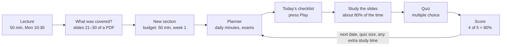
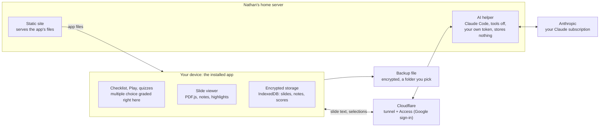

# Honed: Design

Nov 18, 2026 · Nathan and Matt, with Claude. Rewritten after the prototype review (the first, flashcard-based design is in git history). The shared Claude doc is a snapshot; **this file is the one to keep current**: update it in the same PR as any decision that changes it.

## Summary

Honed helps you learn each lecture's material in the time you have: after every lecture you give it the slides and what was covered, it plans that material into your daily study minutes, shows you the original slides in a built-in viewer, and then quizzes you with AI. Quiz results decide how soon, and how heavily, each part comes back.

The prototype is a web app (installable on a phone or computer) that keeps everything on your own device, handles PDF slides, and uses Claude Code (on Matt's and Nathan's subscriptions) for the AI.

**What changed from the first design (Nov 17):** the first design was a flashcard app built around FSRS, with AI turning slides into cards. FSRS was meant as a reference idea, not the product. The core is now the **lecture**: classes, slides studied in their original form, and quizzes. Flashcards are left out for now (maybe a feature later). Spaced repetition survives as the idea behind the schedule, driven by quiz scores instead of card-by-card grades.

Code: [github.com/NandMinc/AW-Study](https://github.com/NandMinc/AW-Study).

## Decisions so far

| Topic | Decision (Nov 18) |
| --- | --- |
| Where data lives | In the app, on each device, encrypted. **Accounts and sync (v2) are designed** (Nov 20, #93: `docs/SECURITY.md`, "Accounts and sync"), opt-in, first for testers on Nathan's home server; not built yet. |
| AI | Matt's and Nathan's Claude subscriptions, through Claude Code running in a locked-down helper on Nathan's home server (each person's own token). Not for other users. |
| Quizzes | Multiple choice for normal studying (graded instantly, no AI). Short answers, graded by AI, for tests and exam practice. **Designed Nov 22 (#117):** questions follow a per-class exam style guide and have levels; regular quizzes may include short answers (two sentences at most), marked by the AI at the end. |
| Slide formats | PDF only for the prototype. Faithful PowerPoint viewing matters later, because exporting some decks to PDF mangles them. |
| Study budget | A lecture's length becomes its first study budget, spread over its first week; quiz results take over after that. Can change. |
| Low scores | A low score marks the section as needing more study, and the planner adds study time in the coming days. It never sends you back into the slides on the spot. |
| Flashcards | Left out for now; maybe a feature later. |

**Still standing:** TypeScript, React and Vite; IndexedDB storage, encrypted as in `docs/SECURITY.md`; the encrypted store and crypto core already built (#15, #16); the name Honed (working); hosting at honed.pacificfish.ca; GitHub at NandMinc/AW-Study, where both Claudes coordinate through `agent-task` issues and either may merge a green PR.

## How it's used

Three moments: setting up once, telling Honed what each lecture covered, and the daily Play button.

**First run**

1. Set up how you unlock (a passphrase or passkey, and the recovery key), since everything is encrypted on the device (#17).
2. A short tutorial shows the main ideas, then helps you **add your classes**: name, which days and times lectures happen, how long they are, and optionally the term's start and end dates and the dates of midterms and finals.
3. Add content from a class: upload a lecture's slides (PDF) and say what was covered.
4. Offer the first study session.

**After each lecture**

- Honed knows when your classes happen, so after one it asks: *What did you cover today?* (in the prototype, when you next open the app; see Open questions).
- Until you do, the Classes page shows a round button for each lecture not filled in yet, by date (Nov 20, #75); they pile up while you're behind, and each opens "What was covered?" for its lecture.
- You answer with the slides and a range, e.g. *slides 21–30 of Week 4.pdf*, or by uploading a new file. The lecture's length (from the class) becomes that section's study budget.

**A normal day**

- The app has three main pages behind a nav bar at the bottom: **Tasks** (the home page), **Classes** and **Settings** (Nov 19; the look is `docs/design/`). Full-screen screens (a class, the slides, a quiz, Play) hide the bar and have a back link.
- The home page is **a short checklist** of today's work, such as *Study CHEM 101, slides 21–30 (25 min)* or *Quiz: Week 3 (10 questions)*, with how much of today's time it uses.
- A big **Play** button runs through the whole checklist in order. Each item is a **study session**: the slides in the viewer for most of the time, then a multiple-choice quiz when the time is up or when you press *I'm ready*. The score decides when that section comes back.
- **The Tasks page (Nov 19, #72; the look is in `docs/design/`):** the checklist grouped by class, in the order the user drags the classes into (saved), each class with a one-word status: *Exam soon* (an exam within 7 days), else *New* (material seen for the first time), else *Review*, and a checkmark when done. The list is worked out from the history **before today**, so it stays put while you work and finished items stay on it, ticked. A lecture is done when its quiz is done; slide time alone ticks nothing. No times are shown. The progress bar weighs each item by its study minutes plus its quiz time: a done item counts in full, and slide time counts for up to 80% of an unfinished item's study part, so the bar creeps while you read and fills with the quizzes. The logic is `src/plan/tasks.ts`; the numbers are in `rules.ts`.
- You can stop at any point; what's left stays on the list.

A lecture becomes a section with a study budget; the planner fits it into your days; each session ends in a quiz, and the score decides when the section comes back, how big its next quiz is, and whether it needs more study time in the coming days. A low score never sends you back into the slides on the spot.

## Classes, lectures and sections

The **section** is what gets scheduled and quizzed: a range of slides covered in one lecture. Everything else hangs off it.

| Thing | What it holds | Example |
| --- | --- | --- |
| Class | Name; lecture days, start times and length; optional term start/end | CHEM 101: Mon/Wed/Fri 10:30, 50 min |
| Exam | Class, date, kind (midterm, final, test), which lectures it covers (default: all so far) | Midterm, Oct 20, lectures 1–12 |
| Slide deck | The PDF itself (encrypted), its title and page count, the text of each page | Week 4.pdf, 42 pages |
| Lecture | Class, date, how long it ran, and the section(s) it covered | Nov 18, 50 min |
| Section | Deck + page range, its lecture, its schedule state (budget left, next quiz date, last scores) | Week 4.pdf, slides 21–30 |
| Annotation | A note, text highlight or area highlight on one page of a deck | Yellow box around the diagram on slide 24 |
| Question | A multiple-choice question for a section: text, options, the right answer, which slide it comes from | "Which bond forms when…?" (slide 26) |
| Quiz attempt | Section, when, questions asked, answers, score, time taken | Nov 19: 4 of 5 |
| Study session | Section, start, minutes on slides, whether a quiz followed | 22 min on slides 21–30 |

- A lecture can cover parts of more than one deck (more than one section), and a deck can be spread over several lectures.
- Quiz attempts and study sessions are only ever added to, never edited: they are the history the schedule learns from.
- **Questions are generated once per section and kept**, so each quiz is drawn from that bank instead of asking the AI every time (see AI).

## Planning the day

The planner turns your sections, their quiz history, upcoming exams and **your daily study minutes** (a setting, e.g. 60) into today's checklist (the minutes are set in Settings; the Tasks page shows no times). It never plans more than your daily minutes, except in the days before an exam, and then it says so.

**A new section (its first week)**

- Its budget is the lecture's length, shared between the lecture's sections by page count. A 50-minute lecture covering one section gives that section 50 minutes.
- That budget is spread over three study sessions in the first week: roughly **day 1, day 3 and day 7** after the lecture, each about a third of the budget, each ending in a quiz.
- **Those quizzes are 10 questions by default** (Nov 19; was 5), more or fewer with how much the section covers: half a question a slide, so 20 slides make 10, never under 5 or over 15. The first quiz after the first week has no score to size it yet, so it's the same size; after that the score table below decides. A quiz started by hand from a class asks 10.

**After the first week: quizzes keep it fresh**

The section moves to short quizzes. Each score sets the next date, the next quiz's size, and any extra study time:

| Last score | Next quiz | Questions | Extra study time, planned in the coming days |
| --- | --- | --- | --- |
| 90% or more | 2.5× the last gap (at least 3 days) | 3 | None |
| 70–89% | 1.5× the last gap | 5 | None |
| 50–69% | in 2 days | 8 | About 10 min more, before the next quiz |
| Under 50% | tomorrow | 10 | About 20 min more, before the next quiz, until scores recover |

The first gap after week one is 7 days. These numbers are a starting point, kept in one settings file so they can be tuned; every quiz and session is recorded, so later they can be fitted to how you actually do (that's where a model like FSRS could come back, underneath).

**Exams**

- From **10 days before** an exam, every section it covers is pulled forward so it's quizzed at least twice before the day, weakest sections first (Nov 20, #86): with no quiz in those days yet, one at once; after one, the next halfway to the exam (at least a day later, by the day before). A section whose study or quiz is already on today gets nothing extra. These go on today even past the daily minutes, and the Tasks page says which exam did it. Nothing is pulled on the exam day itself.
- In the last **2 days**, an *exam practice* item appears: a mixed test with short-answer questions graded by AI
  (#87). It's offered 2 days and 1 day before, until one is done in those days (a practice from earlier doesn't
  count), never on the day. It covers up to 10 of the exam's sections (the weakest, never quizzed counting as
  weakest), shown in lecture order, with 2 multiple-choice and 1 short-answer question each: about 9 minutes for
  2 sections, 44 for 10. It's planned past the daily minutes like the exam's quizzes, and kept apart from the
  section items (`Plan.practice`), since it belongs to an exam, not one section.

**Fitting the day**

1. Collect what's due today or overdue: new-lecture sessions, quizzes, extra study.
2. Order by priority: an exam soon, then the lowest recent scores, then new lectures (fresh material), then the most overdue.
3. Fill today's minutes in that order. What doesn't fit moves to the next days, spread so no day goes over budget.
4. Time estimates: a study item uses its planned minutes; a quiz is counted at about 40 seconds a question until Honed has measured your own pace.

**How it's built (#47):** nothing the planner works out is stored. Each time, it reads the lectures, the study sessions done and the quiz attempts, and works out every section's state and today's list from them, so it stays right after an edit or a delete, and the rules can be retuned against the real history later. Exams pull their sections forward (#86) the same way: worked out from the exams and the quizzes taken.

The day starts at 4 a.m. (`src/lib/studyDay.ts`), so late-night studying counts for the evening before. Missed days simply roll forward into the next days' plans; a proper *catch up* mode is a future idea.

## Study sessions and quizzes

A session is the slides for most of its time, then a quiz; the quiz is what moves the schedule.

**A study session** (e.g. 25 minutes)

1. The section's slides open in the viewer, at its first slide. A quiet timer shows the time left; nothing interrupts.
2. At about **80% of the time** (20 of 25 minutes), Honed offers the quiz; you can also press **I'm ready** at any point, or take a few more minutes.
3. The quiz: multiple choice, drawn from the section's question bank, one question at a time, instant feedback with the right answer and **a link to the slide it came from**.
4. The score is saved and the section's next date and quiz size are set (Planning the day). If it was low, the section is marked as needing more study, and the planner gives it extra study time over the coming days; the session itself simply ends.

**Quiz-only items** (later reviews) skip step 1: just the questions, with *Show me the slide* on each one.

**Questions**

- **Multiple choice** for normal studying: four options, one right, graded on the device instantly with no AI call.
- Generated by AI once per section, sized by the amount of text (Nov 18): about one question per 100 words, at least 3 and at most 10 a page, at least 10 a section. A page of under 20 words (title, divider, "thank you") counts as 1, and the AI is told never to ask about slides that only organise the lecture (title, contents, dividers, thank-you, references). They're still in the section, and still shown when studying. Checked when made: each must name the slide it's from, and its right answer must be among its options. More are generated when a section runs low or keeps being quizzed.
- Within a quiz, questions you got wrong last time come first, and recently asked ones are avoided.
- **Score** = right answers ÷ questions asked. (Designed, #117: weighted by each question's level 1-3, see "Exam style and question levels".)

**Tests and exam practice**

- A mixed test across the lectures an exam covers: multiple choice plus **short-answer questions graded by AI** against the slides, with a mark and one line of feedback each.
- Its results feed each section's schedule like any quiz: it's saved as **one quiz attempt per section**, marked
  with the exam (#87). A short answer counts as one question worth its mark ÷ its points (2 of 3 points is
  0.67 of a question), so the score stays right ÷ asked, now to two places.
- The short-answer questions are written by AI when the practice starts and kept only in the attempt, not
  in the question bank. The multiple choice is marked on the device as always; a short answer's mark is the
  AI's grade, which the device checks (a whole number, 0 to its points) but never makes up. If grading
  fails, the multiple-choice part is still saved and the screen says the short answers weren't marked.
- A practice counts as that section's quiz for the day, so it ticks off the section's item on Tasks.
- **The screen** (#87): a row on Tasks ("Practice for BIO 110's Final (in 2 days)", a tick once done) opens
  `#/practice/<examId>`: what it covers, then **Start**, which has the AI write the short-answer questions (one
  request a section). The questions come one at a time with **no feedback until the end**, like the exam. At the
  end the AI marks each short answer (a blank one gets 0 and isn't sent), then one attempt per section is saved,
  and the results show each answer with its mark, the feedback and what a full answer says. If writing fails:
  **Try again**, or **Practise without short answers** (the multiple choice alone). If marking fails: **Try
  marking again**, or **Save without them** (the unmarked ones don't count, and the results say so). It can be
  done again the same day; each one is saved.

**Keeping it honest:** the score comes from your answers, never from how long you looked at the slides, so the schedule reflects what you actually know.

## Exam style and question levels (#117, designed Nov 22, not built)

Nathan, Nov 22: one of the AI's strengths is reading a course and working out what its exam will ask. So each class
keeps an **exam style guide** that every new batch of questions follows, and each question gets a **level** when it's
made, so new material is studied the way the exam tests it and well-known material gets quick, easy checks.

**Class materials**

- Besides its slides, a class can hold **other documents**: a course outline or syllabus, past exams, practice sets,
  assignment sheets (PDFs and plain text files for now; other types are on the list in "File types to support"), and **the
  student's notes** about the exam ("the prof said: no proofs, two essay questions, formula sheet given").
- Kept like slides: encrypted on the device, synced (opt-in) as files on demand, text read on the device (PDF.js).
  Each has a kind the student picks (outline, past exam, practice, other), because a past exam is the strongest
  signal and the guide should weigh it that way.
- On the class's page under **Exam style**: the materials, the notes box, and the guide.

**The exam style guide**

- A short text (at most about 3,000 characters) the AI writes for the class, with three parts:
  1. **What the exam tests:** topics that matter most, the kinds of questions (recall, explaining, calculating,
     applying a method to a new case), formats (multiple choice, short answer, problems), notation and conventions.
  2. **What each level looks like in this class** (below): e.g. for calculus, level 3 "differentiate
     \(3x^4 - 2x\) with the power rule", level 1 "which rule would you use for \(x^5\)?"; for history, level 3
     "explain in one or two sentences why the treaty failed", level 1 multiple choice on who signed it.
  3. **The mix:** how much of each level and form suits this class (a recall-only class has few worked problems).
- Made by a new AI job, **style**, from the class's name, the notes, the materials' text (past exams first, then
  outlines, then the rest, cut to a limit), a sample of the slides (each lecture's text, cut to fit), and the
  previous guide. Remade when a material or the notes change, and after a new lecture's slides when the guide
  hasn't seen 2 or more of the class's lectures (one request each time; about once a week for most classes).
- The student can **read and edit** it. Once edited, a remake gets the edited version as its previous guide and is
  told to keep the student's changes. **Remake** is a button.
- Every questions request sends the guide with the slides. Exam practice uses it too.
- A class with no guide yet (no slides) gets questions as today, and the first section's questions wait for the guide
  (one request just before).

**Levels**

The AI gives each question a level when it writes it, following the guide's descriptions:

| Level | What it asks | Form | Time counted |
| --- | --- | --- | --- |
| 1 Recognise | Recall or recognise: a term, a fact, which rule or method applies, what a result means | Multiple choice | 20 s |
| 2 Apply | One or two steps of reasoning, a short calculation, applying an idea to a stated case | Multiple choice | 45 s |
| 3 Exam-style | What the exam would ask: a full worked problem, or "explain why", "compare", "what happens if" | Multiple choice (worked problems, wrong options = common mistakes) or a **short answer** | 2 min |

Three levels because the AI can tell them apart reliably; a finer scale would be noise. Questions made before
this count as level 2, multiple choice.

**Scores are weighted by level** (Nathan, Nov 22): a question counts its level, 1, 2 or 3, so
score = Σ (level × how right) ÷ Σ level, where "how right" is 1 or 0 for multiple choice and mark ÷ points for a
short answer. A New quiz of five level-3 and five level-1 questions with only the level-1s right scores 5 ÷ 20 = 25%,
not 50%. Each answer in an attempt keeps the level its question had, so the history stays right if a question is
changed later. Old attempts keep the scores they were saved with (all their questions count as level 2, so
weighting changes nothing for them). The results screen still says "7 of 10 right" and shows the weighted
percentage, the one that moves the schedule.

**Short answers in regular quizzes**

- Level 3 only, when the guide says the exam asks for explanations (a history class gets many, calculus few).
- Kept short (Nathan, Nov 22): the question asks for **at most two sentences**, preferably one, with 1 to 3 points a
  full answer makes, so marking is quick and cheap.
- Banked like multiple choice (written once, asked many times), unlike exam practice's, which are written fresh.
- **Marked by the AI** against their points, **all of a quiz's short answers in one request at the end** (a new
  job, `grade-many`), not one request each. The results screen shows each mark with its feedback; multiple-choice
  feedback stays instant.
- Counted like exam practice's, mark ÷ points of one question, weighted by its level (3) like every question.
- **Offline or the helper unreachable** when a quiz starts: the quiz uses multiple choice only, and says so. If
  marking fails at the end, the multiple-choice part is saved and the short answers aren't counted (as in exam
  practice today).

**Which levels a quiz asks: the section's stage**

Worked out from the section's quiz history each time, like the rest of the planner (numbers in `src/plan/rules.ts`):

| Stage | When | Level 3 / 2 / 1 |
| --- | --- | --- |
| New | First week, or the last score was below 70% | 50% / 35% / 15% |
| Learning | Otherwise | 25% / 50% / 25% |
| Known | The last two quizzes were both 90% or more | 10% / 30% / 60% |
| Exam soon | Within the exam pull (10 days) of an exam covering it | 50% / 35% / 15% |

- Questions you got wrong last time still come first, within these shares.
- **An anchor question:** a Known quiz always has at least one level-3 question. Easy questions alone could keep a
  section "Known" when the student has forgotten how to do the problems; a missed anchor drops it back to Learning.
- The planner counts each question's time by its level (table above), so a Known section's quiz of 3 (two level 1, the anchor) is
  about 3 minutes, and a New one's of 10 about 13. The score table, gaps and sizes stay as they are.
- When a level runs low in the bank, more of that level are asked for.

**What the AI is asked for**

- `questions` gains the guide and how many of each level (and form) to write; each question comes back with its
  `level` (1-3) and `form` (`choice` or `short`; short ones with 1-3 `points` and no options). The stand-on-its-own
  rule (#115) stays.
- New jobs: `style` (the guide) and `grade-many` (a quiz's short answers in one request).
- **Built (#121, Nov 22):** `questions` takes an optional `guide` and `mix` (`{ choice: [level 1, 2, 3], short }`,
  adding up to `count`). Without a mix it writes multiple choice only, each with a level. Short ones come only
  as many as the mix asks for, always level 3, with 1 to 3 points and a one-sentence model answer. `grade-many`
  takes one section's `slides` and up to 20 `items` (question, points, answer, the slide's number). It gives
  one mark per item, all or nothing, so a mark is never guessed. `style` takes the class's name, notes,
  materials (each with its kind and text), lectures (date and slide text) and the previous guide with
  whether it was edited. `styleRequest` in `src/ai/style.ts` fits them into 120,000 characters: the notes
  whole, the materials next (past exams first, at most 60% of the room), then the latest 60 lectures, each
  an equal share of what's left.
- The helper's daily limit (200 requests a person) is plenty: a guide about once a week a class, and one marking
  request per quiz with short answers.

**Privacy:** materials and notes are the student's data like slides: encrypted on the device, sent only to our own
helper as AI inputs, never stored there.

**Building it, in order** (each its own issue and PR; the contract change first, announced in the task issues):

1. Contract and storage: class materials and notes, the guide, `level` and `form` on questions (short ones with
   points), short answers in attempts, each answer's level and the weighted score; sync for the new records and files.
2. Helper: the `style` and `grade-many` jobs; levels, forms and the guide in `questions`.
3. The class page's Exam style: materials, notes, the guide (read, edit, Remake).
4. Bank, picking and planner: stages, level shares, anchors, time by level.
5. The quiz screen: short answers, marking at the end, the multiple-choice-only fallback.

## The slide viewer

Slides are shown exactly as the PDF draws them, with your notes and highlights on top, and AI help one tap away.

**Showing slides**

- **PDF.js** (Mozilla's PDF renderer, open source, Apache-2.0) draws each page in the browser, entirely on the device. It also gives each page's text, which highlighting, search and the AI need.
- One slide at a time, fitted to the screen, with swipe or arrow keys, pinch-zoom on phones, and a strip of thumbnails. Pages render only when near the screen, so a 200-page deck stays quick.
- **Portrait pages** (a Word document saved as PDF) fit the **width** instead and scroll down, so their text isn't tiny on a phone (#46, `src/viewer/fit.ts`). Fit width never draws a page past its real size (PDF.js's 100%), so on a wide screen it stays a page, not 1,300 pixels wide. It's chosen by itself for portrait pages when it makes the page at least 25% bigger; a **Whole page / Page width** button switches (not "Fit width": the zoom's "Fit" button must stay findable by that name), only shown when the two differ, and the choice holds for the rest of the deck. In fit width ↓, Page Down and Space scroll first and move to the next page at the bottom (↑ and Page Up likewise); a new page starts at its top; sideways swipes and pinches still work. Thumbnails fit a 96 × 72 box, so a portrait page's is narrower, never taller.
- **On a phone the Slides page is just the slides** (#110, Nathan, Nov 21): no Honed header (name, Lock) or footer, no previous/next buttons or "Slide N of M" (a swipe and the thumbnails move; the position is still read out by screen readers), no zoom buttons (a pinch zooms), no section label (the thumbnails' underline marks it), and the title is for screen readers only. What's left is one line, "← class" on the left and Whole page / Page width and Notes on the right, over the slides and thumbnails filling the screen. "Phone" is a touch screen with no hover (`(hover: none) and (pointer: coarse)`, CSS only); the computer keeps every control. The section label is always as wide as "Outside this section: …", so the controls after it never move or wrap when it changes.
- The section's range is marked (e.g. slides 21–30); the rest of the deck stays reachable for context.
- Built in #25 as `src/viewer/` (`SlideViewer`, `extractPageText`), on PDF.js's legacy build (wider browser support). PDF.js's worker and data files are served from our own site, so the Content-Security-Policy is unchanged. Until the lecture screens use it, `/viewer-demo.html` shows it on its own.

**Notes and highlights** (stored as annotations, encrypted; the PDF itself is never changed)

- **Text highlight:** select words on a slide, pick a colour.
- **Area highlight:** drag a box over any part of a slide, for diagrams and images.
- **Notes:** attach a note to a highlight, or pin one anywhere on a slide.
- Positions are saved relative to the page, so they line up at any zoom level and screen size.
- Stored per deck and page (`src/types/annotation.ts`, #56), not per section, so they show wherever that slide is open. They can be edited and deleted; deleting a deck or a class deletes them.

**AI in the viewer**

- **Explain this:** select text or an area, and get a fuller explanation in a side panel, based on that slide and its neighbours.
- **Ask about this:** the same, with your own question.
- Either answer can be **kept as a note** on the slide.
- Built in #56 (`src/viewer/AnnotatedViewer.tsx`): a **Notes** panel beside the slides (under them on phones) with **Box**, **Pin a note** and **Ask about this slide**; selecting words offers the colours, Explain and Ask. Explain sends the selection (or the words inside a box) with the slide and its neighbours, nothing else. Ask's question is kept with its answer. The quiz's slide shows no notes for now.

**PowerPoint later.** Browsers can't draw .pptx files faithfully. Options when it's time: (1) convert to PDF on Nathan's server with LibreOffice, which keeps fonts and layout better than most exports but isn't perfect; (2) a JavaScript .pptx renderer in the browser (keeps files on the device; weaker fidelity); (3) keep asking for a PDF export. Test with real problem decks before choosing.

## AI in the prototype

The AI runs as **Claude Code on Nathan's home server**, inside a locked-down helper app, each request on the subscription of whoever made it. That works from phones too. It's for Matt and Nathan only: other users would need another route (e.g. an API key).

**What the AI does**

| Job | When | Input | Output |
| --- | --- | --- | --- |
| Make questions | When a section is added (and when its bank runs low) | The section's slide text | Multiple-choice questions, each with its slide number |
| Write short-answer questions | Exam practice (#87), when it starts | The slide text of the sections the exam covers | Questions, each with the points a full answer makes and its slide number |
| Grade a short answer | Tests and exam practice | Question, expected points, your answer, the slide text | A mark and one line of feedback |
| Explain this | In the viewer | The selection and the slide (plus neighbours) | A short explanation |
| Ask about this | In the viewer | The same, plus your question | An answer |

**Questions stand on their own** (#115): the student sees only the question, never the slide, and the AI only gets each slide's text, never its pictures. So a question never refers to the slides, the lecture or a diagram it doesn't write out: an expert on the subject who has never seen these slides must be able to score perfectly. Where the material can be worked through (maths, physics, code...), some questions are worked problems ("Solve ...") whose wrong options are the answers common mistakes give. The helper drops questions that still point at the slides. The slide number stays, for "see the slide" after answering.

Multiple-choice quizzes need **no AI at the moment you take them**: the bank was made earlier, so quizzes work offline and cost nothing.

**How a request travels**

1. The app sends the request to `honed.pacificfish.ca/ai/…`, the same site, so nothing is shared with another domain.
2. That path is protected by a **Cloudflare Access** application (Google sign-in, Matt and Nathan only), like the admin site. The first time, the app asks you to sign in once.
3. The tunnel sends `/ai/` to the **helper**: a small server in its own TrueNAS app. It knows who you are from Access, and picks **your** Claude Code sign-in token.
4. The helper builds a **fixed prompt** for that job (no free-form commands), runs Claude Code headless (`claude -p`, JSON output), checks the answer's shape (e.g. every question has 4 options, one right, a slide number), retries once if not, and returns it.

**Locked down** (Claude Code is an agent that can run commands, and slide text is untrusted input):

- **All of Claude Code's tools are turned off**: it may only read the prompt and answer in text.
- The helper's container has **no access** to the server's pools or other apps, a read-only filesystem, an unprivileged user, and a memory limit.
- **Nothing is kept:** no request content is logged, and Claude Code's own conversation history is switched off or wiped after each request (to confirm when building).
- **Limits per person** (requests per day, size of each request, a time limit), so a bug can't use up anyone's Claude allowance.
- The sign-in tokens are created by Matt and Nathan (`claude setup-token`) and put on the server by them, never by a Claude.

**In the app**, every AI job goes through one `AiBackend` interface (`makeQuestions`, `makeWrittenQuestions`, `gradeAnswer`, `explain`, `ask`, and `status` for Settings). Tests use a fake, so they never spend usage or send data. Switching later to an API key or a local model means one new backend, not new screens.

**Privacy note:** slide text travels device → Nathan's server → Anthropic for these jobs. The server passes it through without storing it. Data at rest stays only on your devices.

## Data and privacy

Everything stays on the device, encrypted with a key only you can unlock, exactly as built in #15 and #16; only the kinds of records change.

- **Storage:** IndexedDB, with each record's private part encrypted (AES-GCM) under the data key, unlocked by your passphrase or passkey, with a recovery key as backup (`docs/SECURITY.md`).
- **Slide PDFs** are stored encrypted too, as their own records; the viewer decrypts a deck when you open it.
- **What stays readable on disk** (for the database's indexes): ids, which class/lecture/deck/section a record belongs to, and dates (lecture dates, next quiz dates, exam dates, attempt times). Names, slide text, the PDFs, notes, highlights, questions, answers and scores are encrypted. `docs/SECURITY.md` gets an updated table before the new stores are built.
- **Space:** slide decks are a few MB each; a term's worth fits easily, but the app shows how much it uses and asks the browser to keep it permanently (`navigator.storage.persist()`).
- **No accounts yet:** each device has its own data. Moving to a new device is a backup and restore (#18).
- **Accounts and sync (v2, designed Nov 20, #93; built Nov 20-21: accounts #95, records #105, slide PDFs on demand #108):** opt-in, with Google sign-in. Signing in only says which account it is; the data key is still opened only by a passkey, passphrase or recovery key, so the sync server stores ciphertext it can't open. Each device keeps its full local copy (offline, fast, safe from the server going away); the server is a relay. Testing phase: our own sign-in code (OpenID Connect, no hosted service) in a new server app, `honed-sync`, at `/api/` on Nathan's home server, open only to an allow list of emails. The details, including what the server can see, are in `docs/SECURITY.md` ("Accounts and sync"). The order: the server's sign-in and accounts, then syncing the small records, then PDFs on demand. **Remember this device and Google unlock (#97, designed Nov 20; not built):** a device asks for a passkey, passphrase or recovery key once, then opens straight in (Lock forgets it; "Don't remember on this device" for shared computers). Opt-in per person: "Google unlock" lets their Google account unlock a new device, at the cost of the server being able to read their data. Details in `docs/SECURITY.md`. With sync on, the footer's "Your classes and slides stay on this device" becomes "Your classes and slides are encrypted on your device. Only you can read them, even though they sync through our server."
- **What leaves the device:** only the AI jobs' inputs (slide text and your selections or answers), through the helper to Anthropic, never stored on the way.

## Architecture

The app does its work on the device; the server only hands out the app and passes AI jobs to Anthropic.

One web app (TypeScript, React, Vite) installed as a PWA: the checklist, planner, quizzes and viewer all run on the device, offline except for AI jobs. Nathan's server runs two small apps: the static site (already live) and the AI helper (milestone 6), both behind the existing Cloudflare Tunnel, with Access in front of the helper.

## What happens to what's already built

The foundations stay; the flashcard layer on top goes.

| Built | What happens | Why |
| --- | --- | --- |
| Skeleton, server, CI, deploys, honed.pacificfish.ca | **Keep** | Unaffected |
| Study day (`studyDay.ts`, 4 a.m.) | **Keep** | The daily checklist needs it |
| Crypto core (#15), `SECURITY.md` | **Keep** | Slides need it more than cards did |
| Encrypted store pattern, lock/unlock, keyring, migration (#16) | **Keep the machinery, change the records** | A new schema step for classes, lectures, decks, sections, annotations, questions, attempts, sessions |
| Setup and unlock screens (#17, PR #21) | **Keep** | Still the first-run step |
| Backup and restore (#18) | **Keep** | The way to move to a new device |
| Decks, notes and cards: store methods and screens (#6, #7) | **Remove** (kept in git history) | Flashcards are out for now |
| FSRS card scheduling, `buildQueue`, cloze (#5) | **Remove** (kept in git history); FSRS may return underneath the section schedule later | The schedule is now per section, driven by quiz scores |
| `ts-fsrs` dependency | **Remove** with the scheduler | Not used |
| Existing milestone 2 test data on your devices | **Dropped** at the new schema step (it's only test cards) | No migration from cards to sections makes sense |

Removing goes in its own PR after the new pieces exist, so the live site never shows an empty app in between.

## Milestones for the prototype

Finish milestone 3 (encryption) first, then build the lecture loop in slices that are each usable; the AI helper on the server can be built alongside.

| # | Milestone | What's in it | Needs |
| --- | --- | --- | --- |
| 3 | Lock it down (in progress) | Encryption, setup and unlock (#17), backup and restore (#18) | — |
| 4 | Classes and slides | Classes and exams; uploading PDFs; the viewer (pages, zoom, thumbnails); "what did we cover" creating lectures and sections; schema step 3; removing the card screens | 3 |
| 5 | Planner and the daily checklist | Daily minutes setting; the planning rules; today's checklist and **Play**; study sessions with the timer and *I'm ready* (quiz faked until 6) | 4 |
| 6 | AI helper and quizzes | The helper app on the server (locked down, Access, per-person tokens); `AiBackend`; question banks; multiple-choice quizzes; scores moving the schedule | Helper: nothing (can start now). Quizzes in the app: 5 |
| 7 | Viewer tools | Text and area highlights, notes, *Explain this*, *Ask about this* | 4 (AI parts: 6) |
| 8 | First run and prompts | The tutorial; adding classes and first content; "what did you cover?" when you open the app after a class | 5 |
| 9 | Exams | Pulling sections forward before exams; tests and exam practice with AI-graded short answers | 6 |

The prototype is usable for real studying after **6**. Each milestone becomes `agent-task` issues split so Matt's Claude and Nathan's Claude don't touch the same files.

## Open questions and future ideas

Tick a question once Matt and Nathan agree, and write the answer under it.

- [ ] **After-class prompts:** a real notification on your phone needs the server to send pushes (and to know your class times). For the prototype, is asking *when you next open the app* enough, with push later?
- [ ] **Motivation:** the first design had a daily ring, streaks and combos. Keep those ideas for the checklist and Play (e.g. the ring fills as today's list gets done), or leave them for later with leaderboards?
- [ ] **Default daily minutes:** 60? And should some classes get more of the time than others (e.g. a weight per class)?
    - For now (Nov 18, #47): 60, changed in Settings. No weights per class yet.
- [ ] **Exam style and levels (#117):** are the level shares per stage, the times per level and the anchor rule right to start with?
- [x] **Should harder questions count for more?** Nathan (Nov 22): yes, each question counts its level, 1, 2 or 3 (see "Exam style and question levels").
- [ ] **Tuning numbers:** the 80% point for the quiz, about 3 questions per slide, the score table and the day 1/3/7 first week are guesses. Fine to start with and adjust after a few weeks of use?
- [x] **Anthropic's terms:** confirm that running Claude Code headless on the server for your own studying, each on your own subscription, is within them, before the helper goes live.
    - Nathan checked (Nov 18): allowed for each person's own use, on their own subscription, with the official Claude Code CLI, as long as nobody else can run Claude on that login (Access and the helper make sure of that). Headless `claude -p` runs draw on the plan's separate monthly credit for programmatic use, not the normal chat limits.
- [x] **Who sets up the helper's tokens:** each of you runs `claude setup-token` and puts the token on the server (Nathan can add Matt's to the app's settings with him).
    - Done that way (Nov 18): the tokens live in a file on the server that Nathan made (`tokens.env`, outside every Claude's folders). Nathan's is in; Matt's goes in when he has it.

**File types to support**

Today Honed reads PDFs (slides and class materials) and plain text files (class materials). Many more should work
eventually (Nathan, Nov 22). **Whenever a new file type comes up, add it here** with where it came up; solutions are
worked through later, one type at a time.

| Type | Where it came up | Notes |
| --- | --- | --- |
| Word, `.docx` | Course outlines and syllabi as class materials (#117) | Only the text is needed (for the style guide), not a faithful page |
| PowerPoint, `.pptx` | Slides (Nov 18), since exporting some decks to PDF mangles them | Needs a faithful view, not only text: options in "The slide viewer", "PowerPoint later" |

**Future ideas**

- **Catch up:** a backlog for missed lectures, spread over the coming days as extra (cram) time.
- **Practice tests:** generate full practice exams in the style of the past exams uploaded as class materials (#117 covers matching the questions to them).
- **Leaderboards** (needs accounts and a server).
- **Faithful PowerPoint viewing** (see The slide viewer), and other resources: notes, textbook chapters.
- **Flashcards** as a side feature.
